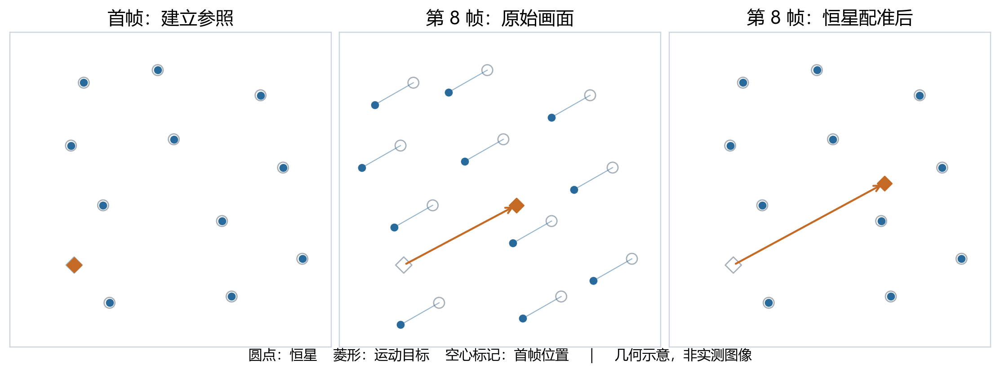
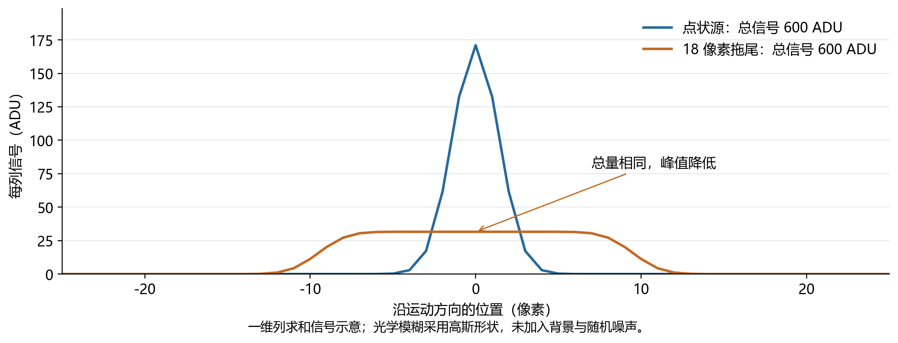

# 星图识别项目：队员学习手册

适用项目：AstraVision / star-chart-recognization  
对应软件版本：national-final-20261018  
文档版本：1.0 · 2026-10-18  
适合读者：没有天文学基础、希望理解算法并完成演示讲解的队员

## 阅读说明

本手册介绍项目如何把连续星空图像变成恒星候选、亮度测量和运动候选轨迹。重点是理解每一步的依据、看懂结果，以及准确说明结果的适用范围。文中的正式结果来自当前版本对官方 rst19 天基数据的验证记录；示意图、算例和注入实验均单独标明。

建议首次按顺序阅读。准备演示时，可重点复习第 5、7、8 节；准备算法答辩时，可重点复习第 3、4、6 节。末尾附有自测题、参考答案和代码阅读入口。

| 学习阶段 | 建议内容 | 学完应能做到 |
|---|---|---|
| 建立直觉 | 第 1—2 节 | 解释相机、恒星和运动目标之间的关系 |
| 理解算法 | 第 3—4 节 | 说明配准、轨迹关联、拖尾检查和测光 |
| 解释结果 | 第 5—6 节 | 区分候选、测量值、实验回收率与真实准确率 |
| 动手复述 | 第 7—9 节 | 查看一条轨迹，算出简单结果，完成三分钟讲解 |

学习目标不是记住所有阈值，而是能回答：输入是什么、程序如何形成结论、证据在哪里、哪些问题目前还不能回答。

## 1. 项目解决什么问题

可以把本项目理解为一次“连续星空观测的测量工作”。相机连续拍摄同一片天空，程序在图像里找光源，用恒星对齐画面，再寻找相对恒星移动的目标。

正式流程输出两类结果。一类是指定图像中的恒星候选，以及其中最暗候选的亮度估计；另一类是整个序列中的运动候选轨迹，包括每次观测的时间、位置和相关测量。这里的“候选”表示通过了当前规则筛选，身份或真实性仍有进一步验证的空间。

这批照片来自卫星上的相机。因此，要同时考虑三个对象：拍照的卫星与相机、远处的恒星背景，以及照片中的运动目标。拍摄平台的运动信息不能直接当成被摄目标的运动信息。

### 1.1 当前使用的数据

| 数据项 | 已核实的内容 |
|---|---|
| 输入 | 官方 rst19 数据，15 张 FITS 图像 |
| 图像大小 | 实际有效像素区为 4096 × 4096 |
| 观测时间 | 2026-03-30 16:32:05.4132—16:32:26.4272 UTC |
| 时间跨度 | 首末帧记录时间相差约 21.014 秒 |
| 单帧曝光 | 1.5 秒 |
| 典型帧间隔 | 1.501 秒，以每帧实际时间戳为准 |
| 默认指定图像 | f7，即第 8 张；编号从 0 开始 |

UTC 是国际通用的时间基准。北京时间是 UTC 加 8 小时。做速度计算时，关键是使用一致的时间基准和正确的时间差；程序不凭帧号假定所有间隔完全相同。

每帧曝光 1.5 秒，表示这一张图积累了约 1.5 秒的光。它与“相邻两帧的时间间隔”是不同概念，不能混用。

### 1.2 软件如何组织

网页工作台负责选数据、启动任务、展示图像和导出结果；Python 分析程序负责读图、检测、几何计算和测量；Docker 固定科学计算环境；本地 Gaia 星表提供已知恒星的位置与亮度参照。正式流程可离线运行。

当前核心采用传统图像处理、几何、统计和物理约束，没有通过训练神经网络来识别目标。学习时应把重点放在证据链上：光源为什么被检出、观测为什么能连成轨迹、拖尾是否支持这条轨迹。

## 2. 先认识六个天文学概念

### 2.1 恒星、人工卫星与空间碎片

恒星是自己发光的天体，太阳也是恒星。其他恒星离我们很远，在本次约 21 秒的观测中，它们彼此的排列可以近似看作不变。人工卫星和空间碎片距离近得多，通常通过反射太阳光进入相机，因此可能相对恒星背景明显移动。

“恒星可作固定参照”是一种适合本次短时观测的近似。恒星也有实际运动，长期精密测量需要考虑；相机指向变化也会让恒星在探测器上移动。

### 2.2 视场与像素

视场就是相机一次看到的天空范围。像素是图像的一个小格子。项目使用 0 起始的像素坐标：x 表示列，向右增加；y 表示行，向下增加。

一个星点通常覆盖多个像素。利用这些像素的信号分布，可以估计比一个像素更细的中心位置，因此出现 x = 973.238 这样的坐标很正常。小数位多只表示数值记录精细，不自动保证测量同样准确。

### 2.3 角度与距离

天空中两个光点相隔多远，首先测到的是方向之间的夹角。1 度等于 60 角分，1 角分等于 60 角秒，所以 1 度等于 3600 角秒。

角距离和实际距离不同。一只近处的鸟和远处的飞机，可以在视野中移动得一样快，但实际速度不同。仅有图像位移不能直接得到目标的千米/秒速度，还需要距离与观测几何。

### 2.4 视亮度、星等与颜色

视亮度描述“从这里接收到多少光”，同时受天体本身发光能力、距离等影响。它不直接告诉我们天体的大小或真实发光功率。

星等是亮度的对数刻度：数字越大越暗，相差 5 等对应光量相差 100 倍。不同滤光波段测得的星等也可能不同。Gaia G 是 Gaia 的一个宽波段，标准 V 是另一种波段；相机颜色响应未知时，不能把二者当成完全相同的测量。

### 2.5 点扩散函数与拖尾

一个理想点经过真实光学系统后，会变成一小团亮斑。描述这种扩散形状的函数叫点扩散函数，简称 PSF。星点看起来比较大，可能与亮度、聚焦、饱和或光学模糊有关，不能直接推断恒星尺寸。

如果目标在曝光期间移动，积累的光会沿路径铺开，形成拖尾。拖尾长度既与移动速度有关，也与曝光时间有关。它既是识别的线索，也会让弱目标更难检出。

### 2.6 天球坐标与观测者状态

赤经、赤纬可以理解为天空方向的经纬度。J2000 提供一套通用参考方向，名称不表示图像一定拍摄于 2000 年。WGS84 提供地球形状与地理位置的参考体系。姿态四元数是一种表示三维旋转的方法，用来描述设备的朝向。

这批辅助信息中的约 505 千米高度、7.61 千米/秒速度属于拍摄卫星。当前项目没有据此给每条被摄轨迹计算可靠距离、身份或完整轨道。

## 3. 从图像到结果：七步处理流程

整体顺序：读图与异常处理 → 背景估计与光源检测 → 恒星配准 → 恒星重复性核验 / 运动关联 → 拖尾检查 → 星表定标 → 结果与证据输出。

### 3.1 读取 FITS，正确理解像素

FITS 是天文学常用的数据格式，既保存像素数组，也保存时间、曝光等头部信息。像素数值通常使用 ADU，即相机数字读数的单位；ADU 还不是直接的光子数。

这批图像的像素有符号，正式流程屏蔽负值、饱和值及相应邻域，不把负值强行改写成无符号大数。第一行包含非成像辅助数据，也不参与光源识别。排除这些数据时保留原坐标原点，便于回到原图检查。

这一阶段的目的，是避免设备数据、坏值或饱和区域被误当成很亮的天体。

### 3.2 估计背景，再找显著亮区

一个像素的读数可以近似分解成“背景 + 天体信号 + 噪声”。杂散光和传感器读出等因素会使背景不为零，也不处处相同，因此程序按区域估计背景与噪声。

噪声尺度常用 σ 表示。假设某处背景 B = 100 ADU，噪声 σ = 5 ADU，读数 I = 130 ADU，那么高出背景 30 ADU，约为 6σ。这里用的是简化算例，实际程序还包含空间背景估计和区域分割。

正式流程以 4σ 搜索运动光源，以 5σ 统计恒星光源，并要求源区域至少有 5 个相连像素。运动候选另有 80 ADU 的扣背景峰值门槛：它检查检测源在扣背景图像中的峰值，不是原始像素读数，也不是孔径内的总信号。σ 阈值比较信号和局部噪声，ADU 峰值门槛比较扣背景后的数字信号，两者不能互相替代。

阈值降低通常能找回更多暗源，也会引入更多干扰。这是漏检和误报之间的权衡，没有一个脱离数据条件而永远最好的阈值。

### 3.3 用恒星把不同帧配准

配准是计算画面之间的几何对应关系，消除整体错位。可以想象在透明纸上描下星群，通过平移、旋转、缩放，让它和另一张照片中的星群尽量重合。

正式流程每帧最多取 250 个较亮且紧致的源用于配准，寻找对应关系、拟合变换并剔除明显错配。每帧直接对齐到分析序列的首帧，避免把逐帧变换误差一直累积下去。工作台选 f7 主要决定恒星报告和底图，并不表示所有计算都改为以 f7 作配准基准。

图 1 中，原始画面里的恒星随相机一起偏移；配准后恒星回到原位置，而目标仍相对恒星移动。正式数据整段星场中心漂移跨度仅约 0.531 像素，图中为了便于学习，放大了整体漂移。

### 3.4 跨帧核验恒星候选

单帧中的亮点可能是噪声，跨帧重复出现能提供更多证据。默认对指定图像及附近共 6 帧进行核验，要求点状源至少命中 4 帧，对齐后的匹配半径为 3 像素。

匹配采用互为最近邻的一对一规则。直观地说，甲认为乙是最近的对应点，乙也认为甲是最近的对应点，才能成为有效配对；不能让几个源同时认领同一个匹配对象。

默认 f7 得到 12,842 个恒星候选。形状和重复性可以减少误检，但固定缺陷仍可能重复出现，拥挤星场中的相邻源也可能混在一起，所以不能把该数量解释成全部真实恒星数。

### 3.5 按实际时间关联运动轨迹

恒星对齐之后，程序寻找仍在移动的源，并检查它们能否沿一条短时近似匀速的路径相互对应。它使用每帧实际 UTC 时间拟合位置，不只看帧号。

当前正式规则至少需要 4 次跨帧观测，允许最多连续漏检 2 帧，关联半径为 3 像素，搜索速度范围为 1—150 像素/秒，线性拟合 RMS（描述拟合偏差大小，见第 4.3 节）不超过 1.5 像素。候选也不能复用同一条源观测。

允许漏帧，是因为目标可能暂时太暗、经过恒星附近或受到异常区域影响。但缺口太长也更容易接错，因此必须限制。最终轨迹可能只覆盖完整运动过程的一小段。

### 3.6 用拖尾检查运动是否合理

在曝光期间星场基本稳定、目标近似匀速时，拖尾长度 L ≈ v × t。速度 12 像素/秒、曝光 1.5 秒，对应约 18 像素拖尾。

如果跨帧拟合显示一个目标很快，但单帧图像总是很小的圆点，就可能是把无关源连成了假轨迹。正式流程检查拖尾方向与长度，要求至少一半观测与预测相容，并允许光学模糊和测量误差带来的偏差。

本批数据初步形成 28 条运动假设，经过拖尾检查后留下 26 条。这个检查增加了物理证据，但不能单独证明目标身份。

图 2 两条曲线的总信号相同，拖尾的峰值却更低。这解释了为什么“总光量相同”不等于“同样容易检出”。弱拖尾还可能只留下几段亮碎片，导致中心位置偏移。

### 3.7 测光、星表定标与导出

程序用固定半径 5 像素的孔径，即围绕源中心的圆形测量区域，累加扣背景后的信号，并结合曝光时间估计亮度。再用本地 Gaia DR3 星表中的已知恒星确定测光零点，即连接相机读数与星等的标定常数，同时建立像素位置与天空方向的对应关系。

输出包括恒星与目标 CSV、JSON 报告、轨迹总览和原图切片。结果中保留时间、坐标、参数和输入校验信息，便于复核。查某条轨迹时，应将数值、拟合路径和原图证据一起看。

## 4. 必须理解的数学：公式、单位与算例

本节公式帮助建立直觉，不要求背诵推导。先确认变量含义与单位，再做计算。

### 4.1 信号、噪声与阈值

简化判断可写成：I − B > kσ。I 为像素或检测统计量的读数，B 为背景，σ 为噪声尺度，k 为阈值倍数。程序的实际检测还涉及滤波、分割和多像素区域。

算例：B = 100、σ = 5。4σ 对应高出背景约 20，5σ 对应高出背景约 25。阈值比较的是扣除背景后的信号，不能把原始读数 20 直接当成 4σ。

信噪比 SNR 表示信号相对噪声有多强。但单像素阈值与整个源的总信噪比不是同一个量，也不能把“超过 5σ”机械翻译为“这一定是真目标”。

### 4.2 质心：为什么坐标可以有小数

质心可以类比跷跷板的平衡点：信号多的像素权重更大。常见的中心估计思路是 x̄ = Σ(xᵢwᵢ) / Σwᵢ，其中 wᵢ 是处理后的有效信号权重。Σ 表示把各项加起来。

算例：第 10、11 列分别有 30、70 单位信号，中心是 (10 × 30 + 11 × 70) / 100 = 10.7。该算例说明亚像素位置的来源，不代表实际检测只用两列或只用这一个公式。

拖尾碎片、背景扣除不准和邻星混叠都会移动质心，因此小数坐标仍需要误差评估。

### 4.3 最小二乘、残差与 RMS

残差是“观测值减去模型预测值”。最小二乘选择一组参数，使残差平方之和尽量小。配准拟合几何变换，运动关联拟合速度与起点，它们都需要评估剩余偏差。

RMS = √[(d₁² + d₂² + … + dₙ²) / n]。dᵢ 是第 i 个非负距离残差，n 是观测数量。平方使较大的偏差更显著，开方把结果恢复到原单位；同样的方法用于有正负的坐标残差时，还能避免正负值直接相加而抵消。

如果两个距离残差为 0.1 和 0.3 像素，RMS 约为 0.224 像素。少数很大的残差会显著影响结果，所以拟合时还需要识别错配和离群点。

配准 RMS、轨迹拟合 RMS、星表位置 RMS 衡量不同事情；前两者常用像素，后者可用角秒。它们不能互相替代，也不是识别正确率。

### 4.4 速度与短弧直线模型

vₓ = Δx / Δt，vᵧ = Δy / Δt，总像素速度 v = √(vₓ² + vᵧ²)。Δ 表示两个时刻之间的差。

算例：1.5 秒内横向移动 18 像素、纵向不动，速度是 12 像素/秒。路径模型写成 x(t) = x₀ + vₓ(t − t₀)，y(t) = y₀ + vᵧ(t − t₀)。

短弧是较短的观测时间段。目标真实轨道可能是弯曲的，在这段图像投影中却可近似匀速直线。这个模型的适用性由观测残差检验；它本身不提供唯一轨道。

### 4.5 曝光时间与拖尾长度

L ≈ v × t_exp，其中 L 的单位是像素，v 的单位是像素/秒，t_exp 的单位是秒。12 × 1.5 = 18 像素；如果速度不变、曝光减半，理想拖尾长度也减半。

曝光缩短通常也减少收集到的光，所以不能只追求短拖尾。这里用的是匀速、曝光期间星场基本稳定的近似，真实成像还受 PSF、姿态变化和邻星影响。

### 4.6 星等与测光零点

m = ZP − 2.5 × log₁₀(F / t_exp)。m 是星等，F 是扣背景后的孔径总信号，t_exp 是曝光时间，ZP 是该测量系统的零点。

log₁₀ 是以 10 为底的对数，可理解为“10 要乘方几次才得到这个数”。信号率增加 10 倍，对数增加 1，星等减少 2.5；信号率增加 100 倍，星等减少 5。

本次最暗恒星候选 F ≈ 231.2039 ADU，t_exp = 1.5 秒，信号率约 154.136 ADU/秒；零点 ZP ≈ 19.9978。代入得到 m ≈ 14.528，报告为约 14.53 等。

零点由已知恒星提供参照，不是为得到某个期望答案随意设置。若两颗星的星等分别为 10 和 15，在同一波段比较时，前者的接收光量约为后者的 100 倍。

### 4.7 像素速度与角速度

角速度 ≈ 像素速度 × 像元尺度。本批星表匹配得到平均像元尺度约 8.443 角秒/像素，因此 12 像素/秒约为 101.3 角秒/秒。

从角速度换成横向实际速度，还需要距离。小角度近似下 v_横 ≈ r × ω，其中 r 是观测者到目标的视线距离，ω 必须换成弧度/秒。弧度也是角度单位，1 弧度约为 206265 角秒。这个关系首先描述相对视线的横向运动，仍需区分观测者与目标的运动；当前流程不利用这条近似直接给目标报千米/秒速度。

### 4.8 召回率与精确率

TP 是找对的目标，FN 是漏掉的目标，FP 是误报。召回率 = TP / (TP + FN)，回答“存在的目标找回多少”；精确率 = TP / (TP + FP)，回答“报告的结果有多少是真的”。

算例：已知有 10 个目标，找到其中 8 个，又误报 2 个，则召回率和精确率都是 80%。如果没有完整真值，就不能直接计算完整真实场景的这两个指标。

## 5. 如何准确解释正式结果

以下数值对应官方 rst19 全序列、默认指定 f7、离线 Gaia 定标的已验证结果。更换指定图像后，恒星统计和最暗候选可能变化。

| 项目 | 结果 | 正确含义 |
|---|---|---|
| 恒星候选 | 12,842 | 指定帧中通过点状形态与跨帧核验的候选 |
| 运动候选轨迹 | 26 | 通过当前关联与拖尾规则，身份尚未确认 |
| 目标位置记录 | 294 行 | 所有轨迹逐帧观测记录之和，不是 294 个目标 |
| 单条轨迹观测数 | 4—15 帧 | 有些仅恢复了较短片段 |
| 最暗候选坐标 | (973.238, 2164.705) | 0 起始像素坐标，x 为列、y 为行 |
| 最暗候选重复性 | 4/6 帧 | 在用于核验的 6 帧中命中 4 帧 |
| 最暗候选星等 | 约 14.53 | Gaia G 参照估计，不是完整探测极限 |
| 星场配准 RMS | 中位数约 0.0643 像素 | 参考星场对齐残差，不是每个目标的位置精度 |
| 星表位置匹配 | 588 个，RMS 约 0.823 角秒 | 与 Gaia 星表的方向拟合残差 |
| 测光定标 | 460 颗星，散度约 0.086 等 | 零点配对的离散程度，不是总测光误差 |
| 候选速度 | 约 5.68—38.42 像素/秒 | 相对配准星场的图像速度 |

### 5.1 “最暗候选”与“探测极限”的区别

最暗候选是在本次筛选集合中找出信号最小的有效源。探测极限则需要定义在某种条件下，多暗的源还能以多高概率被发现，通常需要系统的注入回收测试和完整性分析。

找到一颗 14.53 等候选，不能推出所有比它亮的恒星都被找到，也不能推出更暗的恒星一定找不到。拥挤、坏像素、边界、背景和形态都会影响检测。

### 5.2 三种误差不要混淆

重复观测的随机起伏、参考匹配的离散程度，以及颜色响应等引起的系统偏差，是不同误差来源。0.086 等只是本次零点配对散度；相机波段未知、颜色修正不完整等问题仍存在，不能把它作为完整误差条。

同样，0.0643 像素的星场配准残差不能替代弱拖尾中心的定位误差。明亮紧致参考星与暗弱拖尾的成像条件不同。

## 6. 如何验证算法：知道答案的实验

### 6.1 为什么需要注入实验

官方图像缺少完整目标真值，无法直接知道 26 条轨迹中每一条的身份，也无法枚举所有漏掉的目标。项目在真实背景中加入位置、速度、总信号已知的模拟目标，再运行检测，最后检查能否找回。

加入时记录的正确答案叫真值。真值只进入运行后的评分，不提供给识别程序；否则就会出现用答案指导检测的循环。真实背景保留了复杂星场和噪声，但模拟目标的形状仍受模型假设限制。

### 6.2 最新三组对照应怎样读

在同一官方序列的新区域中，三组使用相同的一批 27 个注入目标，按既定的一对一匹配规则评价。

| 流程 | 找回注入目标 | 回收比例 | 新增未归属轨迹 |
|---|---|---|---|
| 正式 80 ADU 扣背景峰值门槛 | 14/27 | 51.9% | 0 |
| 扣背景峰值门槛降为 40 ADU | 18/27 | 66.7% | 5 |
| 40 ADU + 拖尾重定位 | 21/27 | 77.8% | 1 |

从 14 增加到 21 的 7 个目标中，4 个来自降低阈值，另外 3 个来自重定位，不能把全部增益都归给重定位。新增未归属轨迹可能是真实背景目标、错误关联或碎片；没有完整真值时，不能直接全部叫误报。

回收要求至少 4 次观测匹配，且预测轨迹中至少 80% 的观测在真值 3 像素内；采用一对一分配，同一个注入目标不能被多个碎片重复计分。通过回收规则也不代表恢复完整，例如有目标只恢复了 15 帧中的 4 帧。

### 6.3 重定位是什么，为什么仍是实验功能

弱拖尾可能只被分割出一段较亮碎片，原来的质心会偏离整个拖尾中心。重定位尝试用“匀速拖尾加 PSF”的模型拟合实际像素，以测得的轨迹速度为初值，估计更合理的中心。拟合不可靠时保留原检测结果。

它没有使用注入真值来初始化目标位置，也不能补出本来就没有检出的观测。邻星混叠、短轨迹和中心偏差仍可能存在，所以正式版保留 80 ADU 流程，重定位作为实验工具交付。

注入使用匀速拖尾和高斯 PSF，未额外加入源光子噪声；同一序列的新区域也不等于另一台设备或另一个夜晚的独立验证。读过并用于调整规则的数据，应视为开发或诊断资料，不能继续当作从未见过的测试集。

### 6.4 消融、软件测试与复现各回答什么

消融实验一次移除一个组件，观察结果怎样变化。例如，合成实验完整流程得到 TP/FP/FN = 15/0/3，去掉拖尾检查后为 15/9/3。这支持拖尾检查在这些受控场景中减少了错误轨迹，不能推广成真实数据永远零误报。

软件测试检查实现是否按预期工作。最终版记录为 638 项测试中 592 项通过、46 项跳过、0 失败、0 错误；跳过与历史数据、真实 TLE 或 GPU 缺失有关。它不等于 638 个真实目标全部识别正确。

离线复现检查固定程序、数据与环境能否得到一致结果。它支持结果可重复，但可重复的结果仍可能包含模型偏差，需要独立的科学验证。

## 7. 队员操作练习：把解释落实到证据

使用已启动的工作台或按项目的 `docs/final-demo.md` 启动最终版。以下练习以官方 rst19、f7、离线 Gaia 定标为例。不要修改冻结交付包里的代码、配置或校验清单。

1. 核对数据集和指定帧。说出 f7 是第几张、每张曝光多久，以及本次用了多少帧。
2. 运行分析或打开注明来源的已保存结果。区分“本次运行结果”和历史记录，避免把保存的结果当成本次重新计算。
3. 在结果区找出 12,842、26、294 和 14.53。分别用完整句子解释它们，不能只背数字。
4. 选择一条轨迹，查看首、中、末时刻的原图切片。寻找目标位置变化、拖尾方向、邻星或缺帧线索。
5. 拖动时间滑块。说明底图是固定参考图，变化的是轨迹坐标；它不是原始图像逐帧播放。
6. 下载目标 CSV，按同一个 `target_id` 筛选并按 `time_utc` 排序。用 `x_sky_px`、`y_sky_px` 两列的坐标差除以实际时间差，估算相对星场的速度；这两列是同一配准参考系下的像素坐标，名称里的 sky 不表示赤经赤纬。`x_det`、`y_det` 是各帧原图坐标，直接求差会混入相机变化。局部两点估计与多点拟合可能不同。
7. 查看最暗恒星候选及其 4/6 命中情况。说明这是一颗候选的测量，不能直接推出相机完整探测极限。
8. 检查右侧亮度曲线的口径。固定孔径可能漏掉长拖尾的光，因此不把该曲线当成完整目标的精密光变曲线。

建议两人搭档：一人操作，一人只提证据问题，例如“这个数的单位是什么”“在哪张原图能看到”“这个结果能否推出目标身份”。再互换角色。

### 三分钟复述练习

前 30 秒介绍卫星相机连续拍摄 15 帧，以及恒星可作短时参照。随后约 60 秒解释背景检测、配准和运动关联。再用约 40 秒说明速度与拖尾的关系、星等如何由已知恒星定标。剩余时间展示一条轨迹和主要结果，并主动说明候选身份、完整性和轨道仍未确定。

这只是学习用讲述节奏，实际计算时间与现场安排需要在比赛电脑上排练，不能把开发机耗时当成所有机器的保证。

## 8. 常见误区与建议表述

| 容易说错的话 | 更准确的表述 |
|---|---|
| 已经识别出 26 颗卫星 | 找到 26 条运动候选轨迹，目标身份尚未确认 |
| 图里所有移动亮点都是目标 | 先校正整体画面变化，再检查相对恒星的运动 |
| 恒星永远不动 | 在本次短时观测中，恒星相对排列近似不变 |
| 294 说明有 294 个目标 | 294 是逐帧位置记录总行数 |
| 能探测到 14.53 等，所以探测极限就是 14.53 | 这是当前筛选集合中最暗候选的 Gaia G 参照估计 |
| 配准 0.064 像素，所以每个目标都同样准 | 该数字描述参考星场配准，弱拖尾定位误差需另评估 |
| 77.8% 是真实识别准确率 | 它是指定条件下 27 个注入目标的回收比例 |
| 轨迹图是一条直线，所以轨道就是直线 | 短时图像投影采用近似直线模型，真实轨道可弯曲 |
| 目标飞行高度是 505 千米 | 约 505 千米是拍摄卫星的辅助信息 |
| 网页滑块播放的是原始星空视频 | 底图固定，滑块切换轨迹坐标；原图证据看切片 |
| 合成实验 FP = 0，所以实际永远无误报 | 零误报只适用于对应受控实验 |

### 历史地基流程与当前天基流程

仓库还保留地面望远镜的历史流程。在望远镜跟踪目标的观测模式中，目标可能在探测器上接近静止，而恒星背景扫过画面，需要同时分析探测器坐标与天空坐标。

当前官方天基流程以相对恒星背景的运动为核心，不能把历史地基的阈值和结果直接套过来。阅读 `src/config/default.yaml` 时尤其注意 `space` 分支，不要只看前面的历史通用配置。当前天基测光使用离线 Gaia 参照，也不能因为历史配置里存在 `truth` 字样，就推断正式检测使用目标答案。

## 9. 自测题

建议先独立作答，再看下一节。解释题以自己的话说清因果关系，比背定义更重要。

1. 这批图像为什么需要区分拍摄卫星与被摄目标？报告中的约 505 千米属于谁？
2. 相机向右偏了一点时，为什么不能把图中所有发生位移的亮点都判成运动目标？
3. 背景为 100 ADU、噪声尺度为 5 ADU，某像素读数为 130 ADU，简化计算高出背景几个 σ？这是否足以确认真实天体？
4. 相邻两次观测间隔 1.5 秒，目标横向移动 18 像素、纵向不变，速度是多少？曝光 1.5 秒时预期拖尾多长？
5. 两颗星分别为 10 等和 15 等，在同一波段中哪颗更亮，光量约相差多少倍？
6. 12,842、26、294 分别统计什么？为什么不能直接把 26 当作真实目标总数？
7. 配准 RMS 很小，为什么弱拖尾的位置仍可能偏差较大？
8. 已知 10 个目标，检出其中 8 个并额外误报 2 个，召回率和精确率各是多少？
9. 最新对照从 14/27 提高到 21/27，能否说“重定位额外找回 7 个目标，真实准确率为 77.8%”？请指出问题。
10. 找到 14.53 等的最暗候选，为什么还不能给出相机的完整探测极限？
11. 时间滑块和原图切片分别展示什么？为什么固定孔径曲线不一定是精密光变曲线？
12. 只有约 21 秒的图像轨迹，为什么不能唯一确定目标距离和完整轨道？还缺少哪些信息或约束？

## 10. 自测参考答案

1. 两者处在不同角色和位置：一个负责拍摄，一个是图中的候选。约 505 千米是拍摄卫星高度，不能赋给被摄目标。
2. 相机变化会让整个星场共同位移。需要先配准，消除共同变化，再寻找相对恒星的额外运动。
3. (130 − 100) / 5 = 6，即高出背景 6σ。单个数值不能排除坏点、噪声或其他干扰，还需区域形态、跨帧证据等。
4. 速度为 18 / 1.5 = 12 像素/秒；预期拖尾约 12 × 1.5 = 18 像素，受 PSF 和观测条件影响。
5. 10 等更亮；相差 5 等，接收光量约相差 100 倍。
6. 分别是指定帧恒星候选数、运动候选轨迹数、目标逐帧位置记录数。真实图像没有完整目标真值，候选中可能有干扰，也可能漏掉目标。
7. 配准使用较亮、紧致的参考源；弱拖尾可能被分成碎片或与邻星混叠。参考系对齐误差与目标中心估计误差不同。
8. TP = 8、FN = 2、FP = 2。召回率 8/10 = 80%，精确率 8/(8 + 2) = 80%。
9. 7 个增益中 4 个来自降低阈值，3 个来自重定位；77.8% 是特定注入实验的回收比例，不能当作完整真实场景准确率。
10. 最暗候选是筛选集合中信号最小、对应星等数值最大的有效候选；完整探测极限需要在规定背景、位置、形态和成功率条件下进行系统测试。
11. 滑块切换固定底图上的轨迹坐标，切片展示具体时刻的原图局部证据。固定孔径可能漏掉长拖尾的部分光，也可能受邻星影响。
12. 图像首先提供方向及其随时间变化，缺少可靠距离等约束；短弧可能与多种轨道相容。需要更充分的观测、可靠视线方向、观测者状态和适当的定轨或身份关联证据。

合格标准建议：能正确解释第 1、2、6、9、10 题，并独立完成第 3、4、5、8 题的计算；其余题能结合原图或程序步骤说明原因。该标准是队内学习建议，不是算法验收指标。

## 附录 A：术语速查

| 术语 | 本项目中的含义 |
|---|---|
| FITS | 保存天文图像与观测元数据的文件格式 |
| 帧 | 一次成像得到的一张图像 |
| ADU | 相机数字信号单位，不直接等于光子数 |
| 曝光 | 相机积累光信号的时间过程 |
| 背景 | 光源之外的缓慢变化信号基底 |
| 噪声 / σ | 随机起伏及其典型尺度 |
| SNR | 信号相对噪声的强弱比例 |
| 分割 | 将符合条件的相邻像素归成源区域 |
| 质心 | 根据源信号分布估计的中心位置 |
| PSF | 理想点经过成像系统后的亮斑分布 |
| 配准 | 计算图像之间的几何对应，使参照源对齐 |
| 一对一匹配 | 同一个对应对象不能被多个候选重复认领 |
| 最小二乘 | 最小化残差平方和的参数拟合方法 |
| 残差 / RMS | 观测与模型的差，以及差异的均方根尺度 |
| 拖尾 | 目标在曝光期间移动形成的光迹 |
| 孔径测光 | 在指定区域内累加扣背景后的信号 |
| 星等 / 零点 | 对数亮度刻度，以及连接相机读数的标定常数 |
| Gaia DR3 | 本次使用的恒星位置和亮度参照星表 |
| 赤经 / 赤纬 | 描述天球方向的一组坐标 |
| 像元尺度 | 每个像素对应的天空角度 |
| 短弧 | 时间跨度较短的一段目标观测 |
| 真值 | 实验中已知的正确位置、身份或存在性等答案 |
| 注入回收 | 加入已知模拟源，再统计算法能否找回 |
| 消融实验 | 移除某个算法步骤，观察其影响 |
| 泛化 | 方法在新场景、新设备等条件下的表现 |
| TLE | 描述地球卫星轨道的两行根数格式；当前候选没有可靠关联身份与对应 TLE |

## 附录 B：资料与代码阅读入口

下列路径均相对于项目根目录。先读报告，再看代码；不必一开始就读完整仓库。正式发行包已经冻结，本学习材料为补充文档。

| 阅读目的 | 项目内路径 |
|---|---|
| 官方数据处理与测量口径 | `docs/reports/rst19-2026-09-23.md` |
| 最终版运行与演示 | `docs/final-demo.md` |
| 最终版测试、冻结与验收 | `docs/reports/final-release-2026-10-18.md` |
| 拖尾重定位实验 | `docs/reports/trail-refinement-2026-10-18.md` |
| 剩余轨迹与失败原因复核 | `docs/reports/final-trail-review-2026-10-18.md` |
| 天基主处理流程 | `src/space_pipeline.py` |
| 恒星报告与核验 | `src/analysis/star_catalog.py` |
| 运动关联 | `src/target/space_motion.py` |
| 拖尾物理检查 | `src/target/trail_check.py` |
| 实验性拖尾重定位 | `src/target/trail_refinement.py` |
| 阈值与分支配置 | `src/config/default.yaml`，重点查看 `space` |

文档维护时应同步核对软件版本、数据集、指定帧和测量口径。示意算例帮助理解公式，正式数值以对应版本的结果文件与验证报告为准。
